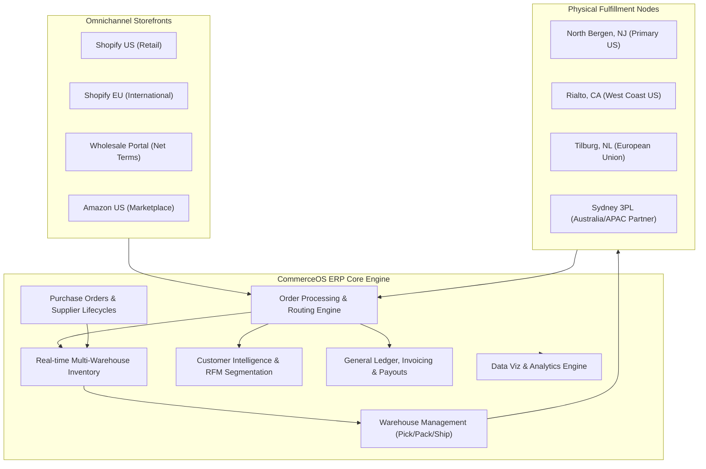
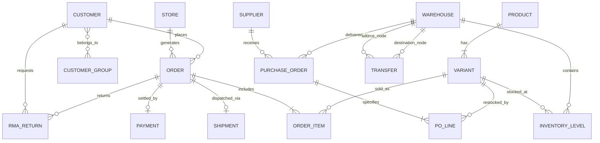
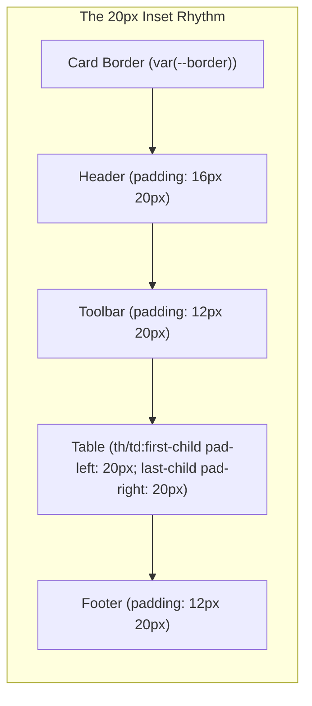
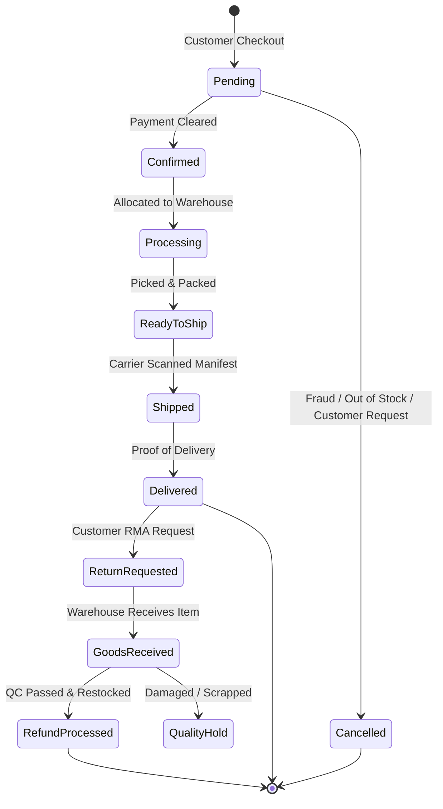
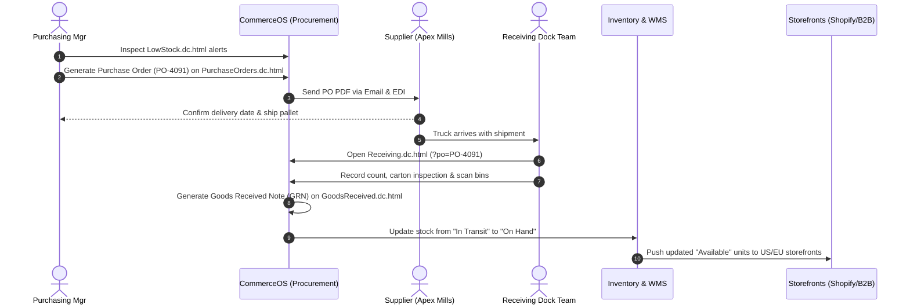
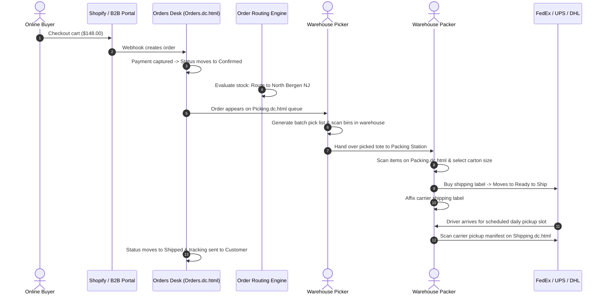
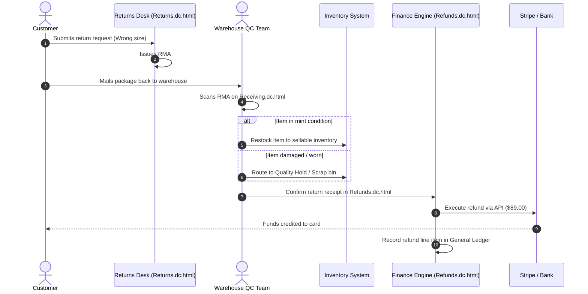
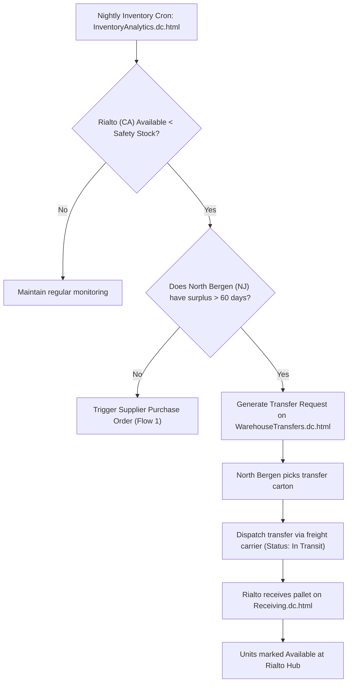
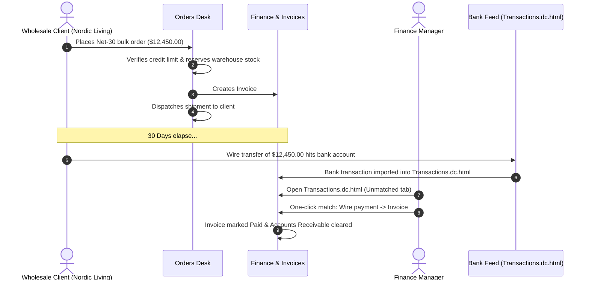

# CommerceOS ERP: Comprehensive System Architecture, Functional Reference & User Flow Manual

> [!NOTE]
> **CommerceOS** is a high-performance, modular enterprise eCommerce Operating System (ERP) engineered for multi-store retail, wholesale (B2B), and marketplace operations. This manual provides a single source of truth for end users, operations managers, supply chain leads, finance teams, and developers.

---

## Table of Contents
1. [Executive Overview & ERP Architecture](#1-executive-overview--erp-architecture)
2. [Multi-Store & Omnichannel Model](#2-multi-store--omnichannel-model)
3. [System Data Architecture & Entity Relationship Model](#3-system-data-architecture--entity-relationship-model)
4. [User Interface, Design System & Ergonomics](#4-user-interface-design-system--ergonomics)
5. [Complete Module & Functional Reference](#5-complete-module--functional-reference)
   - [5.1 Executive Dashboard](#51-executive-dashboard)
   - [5.2 Sales & Order Management](#52-sales--order-management)
   - [5.3 Catalog & Product Management](#53-catalog--product-management)
   - [5.4 Inventory & Stock Control](#54-inventory--stock-control)
   - [5.5 Fulfillment & Logistics](#55-fulfillment--logistics)
   - [5.6 Procurement & Supplier Operations](#56-procurement--supplier-operations)
   - [5.7 Customer Relationship Management (CRM)](#57-customer-relationship-management-crm)
   - [5.8 Marketing & Promotional Engine](#58-marketing--promotional-engine)
   - [5.9 Finance, Accounting & Ledger](#59-finance-accounting--ledger)
   - [5.10 Business Intelligence & Analytics](#510-business-intelligence--analytics)
   - [5.11 Administration, Security & Governance](#511-administration-security--governance)
6. [End-to-End Business User Flows](#6-end-to-end-business-user-flows)
   - [Flow 1: Procurement, Goods Receipt & Stock Availability](#flow-1-procurement-goods-receipt--stock-availability)
   - [Flow 2: Omnichannel Order-to-Cash & Fulfillment](#flow-2-omnichannel-order-to-cash--fulfillment)
   - [Flow 3: Post-Purchase RMA Return, Inspection & Refund](#flow-3-post-purchase-rma-return-inspection--refund)
   - [Flow 4: Low-Stock Detection & Inter-Warehouse Transfer](#flow-4-low-stock-detection--inter-warehouse-transfer)
   - [Flow 5: B2B Wholesale Invoicing & Ledger Reconciliation](#flow-5-b2b-wholesale-invoicing--ledger-reconciliation)
7. [Security, Governance & Audit Trails](#7-security-governance--audit-trails)
8. [Keyboard Shortcuts & Power-User Reference](#8-keyboard-shortcuts--power-user-reference)

---

## 1. Executive Overview & ERP Architecture

CommerceOS replaces fragmented standalone SaaS applications (separate inventory managers, warehouse management systems, CRM databases, accounting spreadsheets, and order desks) with a unified, tightly coupled data engine and cohesive operational UI.

### Architectural Tenets
1. **Zero Data Latency:** Inventory reservation, customer order tracking, and financial ledgers update synchronously across all channels.
2. **Deterministic State Transitions:** Orders, RMAs, Transfers, and POs adhere to strict state machines with validation guards against illegal states (e.g. shipping unpicked orders or refunding uninspected goods).
3. **Ergonomic Density:** Built on standard 20px card insets, tabular numeric alignment, dual light/dark modes, and single-key shortcuts for rapid operations desk execution.

---

## 2. Multi-Store & Omnichannel Model

CommerceOS natively partitions and aggregates data across 4 distinct sales channels:

| Store Channel | Channel Key | Business Model | Primary Currency | Fulfillment Strategy | Revenue Share |
|---|---|---|---|---|---|
| **Fernhill US** | `us` | Direct-to-Consumer (DTC) | USD ($) | North Bergen (NJ) & Rialto (CA) | ~26.0% |
| **Fernhill EU** | `eu` | International DTC | EUR (€) | Tilburg Hub (Netherlands) | ~19.7% |
| **Wholesale** | `wholesale` | B2B Commercial Accounts | USD ($) Net 30/45 | Cross-docking & North Bergen bulk | ~48.9% |
| **Amazon US** | `amazon` | FBM / 3P Marketplace | USD ($) | Rialto (CA) dedicated bin allocation | ~5.4% |

Users can filter any view across the system to a single store channel using the top navigation bar or analyze consolidated multi-store revenue ($820,443/month).

---

## 3. System Data Architecture & Entity Relationship Model

The core relational backbone connects Products, Inventory Allocations, Customer CRM records, Orders, Warehouses, and Financial Transactions:

### Data Synchronization Layer
- **`catalog.js`**: Master catalog of 42 high-volume active SKUs, product options, hierarchical collections, and customer reviews.
- **`inventory.js`**: Exact stock quantities across all 4 fulfillment centers: On Hand, Allocated, In Transit, and Available.
- **`orders.js`**: 2,846 live orders with deterministic chronological status, carrier tags, line items, and risk scoring.
- **`fulfillment.js`**: Queue generators for pick lists, packing station bins, shipping slots, and carrier manifests.
- **`procurement.js`**: Vendor records, open PO contracts, goods receipt notes (GRN), and Return to Vendor (RTV) claims.
- **`finance.js`**: Merchant fee deductions, payout settlements, customer invoices, corporate expense allocations, and reconciliation tables.

---

## 4. User Interface, Design System & Ergonomics

The CommerceOS interface is governed by a unified Design System that guarantees visual rhythm, responsiveness, and speed.

### Grid Rhythm & Spacing Standards
- **Standard Card Inset (`--space-20`):** Every card header (`.cx-card-head`), card body (`.cx-card-body`), table margin, toolbar, and drawer panel starts its content precisely **20px in**.
- **Container Gutters:**
  - **Desktop (≥1280px):** 32px top-bar padding, 24px/32px page container padding, max-width 1600px.
  - **Tablet (768px–1279px):** 24px top-bar padding, 24px page padding, 64px icon rail sidebar.
  - **Mobile (<768px):** 16px top-bar padding, 16px page padding, drawer navigation, scroll-snapped horizontally swipeable KPI tiles.
- **Tabular Figures:** All currency amounts, SKUs, timestamps, and inventory units utilize monospaced numeric formatting (`font-feature-settings: "tnum" 1`) to eliminate visual column jitter.

---

## 5. Complete Module & Functional Reference

### 5.1 Executive Dashboard
- **File:** [`Main.dc.html`](file:///Users/saiham.info21gmail.com/Documents/Dev%20Projects/ecommerceOS/dashboard-preview/Main.dc.html)
- **Role:** High-level command center for leadership and operations leads.
- **Core Elements:**
  - **Store Switcher:** Live toggle between US, EU, Wholesale, Amazon, or All Stores.
  - **KPI Ribbon:** Total Revenue, Net Orders, Average Order Value (AOV), and Conversion Rate with period-over-period delta indicators.
  - **Interactive Sales Velocity Chart:** Dual-series daily revenue plot with hover crosshairs, brush zoom, and previous-period comparison dashes.
  - **Needs Attention Tasks Queue:** Algorithmic prioritization of actionable alerts (processing bottlenecks, stockout risks, pending refunds, overdue vendor deliveries).
  - **Order Pipeline Funnel:** Real-time visibility into order states (Pending -> Confirmed -> Processing -> Ready to Ship -> Shipped) with target cycle times.

---

### 5.2 Sales & Order Management
- **Files:** [`Orders.dc.html`](file:///Users/saiham.info21gmail.com/Documents/Dev%20Projects/ecommerceOS/dashboard-preview/Orders.dc.html), [`AbandonedCarts.dc.html`](file:///Users/saiham.info21gmail.com/Documents/Dev%20Projects/ecommerceOS/dashboard-preview/AbandonedCarts.dc.html), [`Returns.dc.html`](file:///Users/saiham.info21gmail.com/Documents/Dev%20Projects/ecommerceOS/dashboard-preview/Returns.dc.html), [`Refunds.dc.html`](file:///Users/saiham.info21gmail.com/Documents/Dev%20Projects/ecommerceOS/dashboard-preview/Refunds.dc.html), [`SalesChannels.dc.html`](file:///Users/saiham.info21gmail.com/Documents/Dev%20Projects/ecommerceOS/dashboard-preview/SalesChannels.dc.html), [`DeliveryTracking.dc.html`](file:///Users/saiham.info21gmail.com/Documents/Dev%20Projects/ecommerceOS/dashboard-preview/DeliveryTracking.dc.html)
- **Role:** End-to-end sales processing, customer support triage, and post-purchase reverse logistics.

- **Functional Highlights:**
  - **Faceted Filters & Saved Views:** Filter orders by fulfillment stage, payment status, warehouse source, delivery date, or customer segment. Save custom views with star prioritization.
  - **Bulk Action Toolbar:** Select multiple orders for batch fulfillment allocation, tag assignment, PDF picking slip export, or batch cancellation.
  - **Abandoned Cart Engine:** Real-time tracking of checkout drop-offs with recovery emails and coupon attribution.
  - **Reverse Logistics (RMA):** Integrated returns portal managing reverse shipments, restocking inspection, restocking fees, and instant Stripe/processor refund triggers.

---

### 5.3 Catalog & Product Management
- **Files:** [`Products.dc.html`](file:///Users/saiham.info21gmail.com/Documents/Dev%20Projects/ecommerceOS/dashboard-preview/Products.dc.html), [`Categories.dc.html`](file:///Users/saiham.info21gmail.com/Documents/Dev%20Projects/ecommerceOS/dashboard-preview/Categories.dc.html), [`Collections.dc.html`](file:///Users/saiham.info21gmail.com/Documents/Dev%20Projects/ecommerceOS/dashboard-preview/Collections.dc.html), [`Attributes.dc.html`](file:///Users/saiham.info21gmail.com/Documents/Dev%20Projects/ecommerceOS/dashboard-preview/Attributes.dc.html), [`ProductReviews.dc.html`](file:///Users/saiham.info21gmail.com/Documents/Dev%20Projects/ecommerceOS/dashboard-preview/ProductReviews.dc.html)
- **Role:** Master product taxonomy, variant matrices, channel merchandising, and customer sentiment.
- **Core Elements:**
  - **SKU & Variant Hierarchy:** Manage multi-dimensional products (Size × Color × Material) with individual barcodes (UPC/EAN/GTIN), weights, and cost of goods sold (COGS).
  - **Channel Syndication Rules:** Control channel-specific pricing, product titles, and channel listing exclusions (e.g. wholesale-only bundles vs. DTC exclusives).
  - **Taxonomy Trees:** Multi-level parent/child categories and rule-based dynamic collections (e.g. "Waterproof Outerwear with Margin > 45%").
  - **Review Sentiment Moderation:** Customer review verification, verified buyer badge enforcement, and profanity/link automated moderation filters.

---

### 5.4 Inventory & Stock Control
- **Files:** [`InventoryOverview.dc.html`](file:///Users/saiham.info21gmail.com/Documents/Dev%20Projects/ecommerceOS/dashboard-preview/InventoryOverview.dc.html), [`StockLevels.dc.html`](file:///Users/saiham.info21gmail.com/Documents/Dev%20Projects/ecommerceOS/dashboard-preview/StockLevels.dc.html), [`LowStock.dc.html`](file:///Users/saiham.info21gmail.com/Documents/Dev%20Projects/ecommerceOS/dashboard-preview/LowStock.dc.html), [`StockAdjustments.dc.html`](file:///Users/saiham.info21gmail.com/Documents/Dev%20Projects/ecommerceOS/dashboard-preview/StockAdjustments.dc.html), [`StockByWarehouse.dc.html`](file:///Users/saiham.info21gmail.com/Documents/Dev%20Projects/ecommerceOS/dashboard-preview/StockByWarehouse.dc.html), [`WarehouseTransfers.dc.html`](file:///Users/saiham.info21gmail.com/Documents/Dev%20Projects/ecommerceOS/dashboard-preview/WarehouseTransfers.dc.html)
- **Role:** Multi-echelon stock health monitoring, stock valuation, and rebalancing.

| Inventory Bucket | Definition | Formula / Impact |
|---|---|---|
| **On Hand** | Total physical units physically present in the warehouse bins. | Counted during cycle counts. |
| **Allocated** | Units committed to pending/processing customer orders. | Locks units from being sold again. |
| **Available** | Units ready to be sold immediately across storefronts. | `On Hand - Allocated` |
| **In Transit** | Units shipped from suppliers or moving between warehouses. | Expected arrival dates update velocity forecasts. |
| **Safety Stock / Reorder Point** | Threshold trigger that generates automated replenishment requests. | `Lead Time Demand + Buffer Stock` |

- **Functional Highlights:**
  - **Reorder Automation:** When available stock falls below safety stock, automated low-stock badges trigger supplier purchase orders or warehouse transfers.
  - **Audit Cycle Counts:** Full adjustment audit log capturing reason codes (Damaged, Theft, Found, QC Hold) with employee signatures.
  - **Transfer Dispatch Board:** Kanban-style transfer management tracking transit status from Draft -> Dispatched -> In Transit -> Received.

---

### 5.5 Fulfillment & Logistics
- **Files:** [`FulfillmentOverview.dc.html`](file:///Users/saiham.info21gmail.com/Documents/Dev%20Projects/ecommerceOS/dashboard-preview/FulfillmentOverview.dc.html), [`Picking.dc.html`](file:///Users/saiham.info21gmail.com/Documents/Dev%20Projects/ecommerceOS/dashboard-preview/Picking.dc.html), [`Packing.dc.html`](file:///Users/saiham.info21gmail.com/Documents/Dev%20Projects/ecommerceOS/dashboard-preview/Packing.dc.html), [`Shipping.dc.html`](file:///Users/saiham.info21gmail.com/Documents/Dev%20Projects/ecommerceOS/dashboard-preview/Shipping.dc.html), [`Warehouses.dc.html`](file:///Users/saiham.info21gmail.com/Documents/Dev%20Projects/ecommerceOS/dashboard-preview/Warehouses.dc.html)
- **Role:** High-velocity shop-floor warehouse management system (WMS).
- **Core Elements:**
  - **Batch Picking Lists:** Algorithmic route-optimized pick lists that group items across multiple orders into serpentine bin paths (Aisle -> Bay -> Shelf -> Bin).
  - **Packing Station Console:** Touch-friendly barcode scanning interface verifying SKU matches before cartons are sealed. Box recommendation algorithm calculates dimensional weight.
  - **Shipping Slots & Carrier Pickup:** Manifest builder partitioned by carrier (FedEx Ground, UPS 2nd Day, DHL Express, Royal Mail) with live cutoff clocks.

---

### 5.6 Procurement & Supplier Operations
- **Files:** [`PurchaseOrders.dc.html`](file:///Users/saiham.info21gmail.com/Documents/Dev%20Projects/ecommerceOS/dashboard-preview/PurchaseOrders.dc.html), [`Suppliers.dc.html`](file:///Users/saiham.info21gmail.com/Documents/Dev%20Projects/ecommerceOS/dashboard-preview/Suppliers.dc.html), [`Receiving.dc.html`](file:///Users/saiham.info21gmail.com/Documents/Dev%20Projects/ecommerceOS/dashboard-preview/Receiving.dc.html), [`GoodsReceived.dc.html`](file:///Users/saiham.info21gmail.com/Documents/Dev%20Projects/ecommerceOS/dashboard-preview/GoodsReceived.dc.html), [`PurchaseReturns.dc.html`](file:///Users/saiham.info21gmail.com/Documents/Dev%20Projects/ecommerceOS/dashboard-preview/PurchaseReturns.dc.html)
- **Role:** Vendor management, inbound purchase orders, dock receiving, and vendor disputes.
- **Core Elements:**
  - **PO Lifecycle:** Draft -> Sent to Supplier -> Partially Received -> Received -> Billed.
  - **Dock Receiving Console:** Receiving dock operators scan delivered pallets, record carton counts, flag damaged cartons, and generate Goods Received Notes (GRN).
  - **Three-Way Matching:** Discrepancy detector matching Purchase Order quantities against Goods Received Notes and Supplier Invoices.
  - **Return to Vendor (RTV):** Manages supplier chargebacks for defective goods and return-to-factory freight.

---

### 5.7 Customer Relationship Management (CRM)
- **Files:** [`Customers.dc.html`](file:///Users/saiham.info21gmail.com/Documents/Dev%20Projects/ecommerceOS/dashboard-preview/Customers.dc.html), [`CustomerGroups.dc.html`](file:///Users/saiham.info21gmail.com/Documents/Dev%20Projects/ecommerceOS/dashboard-preview/CustomerGroups.dc.html), [`Segments.dc.html`](file:///Users/saiham.info21gmail.com/Documents/Dev%20Projects/ecommerceOS/dashboard-preview/Segments.dc.html), [`CustomerActivity.dc.html`](file:///Users/saiham.info21gmail.com/Documents/Dev%20Projects/ecommerceOS/dashboard-preview/CustomerActivity.dc.html)
- **Role:** 360-degree customer intelligence, lifetime value (LTV) analytics, and automated cohort segmentation.
- **Core Elements:**
  - **Unified Customer Ledger:** Tracks order history, total spend, address book, payment tokens, tax exemption certificates, and customer support tickets.
  - **RFM Segmentation Engine:** Segments customers into Champions, Loyalists, Potential Loyalists, At Risk, and Dormant based on Recency, Frequency, and Monetary parameters.
  - **B2B Groups & Tiers:** Assign custom pricing tiers (Wholesale Tier 1, VIP Creators, Retail) and payment terms (Net 30, Pre-paid credit card).

---

### 5.8 Marketing & Promotional Engine
- **Files:** [`Campaigns.dc.html`](file:///Users/saiham.info21gmail.com/Documents/Dev%20Projects/ecommerceOS/dashboard-preview/Campaigns.dc.html), [`Discounts.dc.html`](file:///Users/saiham.info21gmail.com/Documents/Dev%20Projects/ecommerceOS/dashboard-preview/Discounts.dc.html), [`Coupons.dc.html`](file:///Users/saiham.info21gmail.com/Documents/Dev%20Projects/ecommerceOS/dashboard-preview/Coupons.dc.html), [`Promotions.dc.html`](file:///Users/saiham.info21gmail.com/Documents/Dev%20Projects/ecommerceOS/dashboard-preview/Promotions.dc.html)
- **Role:** Revenue acceleration, campaign tracking, and discount validation.
- **Core Elements:**
  - **Automated Cart Rules:** Free shipping on orders over \$75, Buy-One-Get-One (BOGO), and tiered quantity discounts.
  - **Coupon Engine:** Single-use vs. multi-use promotional codes, creator affiliate tracking, and maximum usage quotas.
  - **Marketing Campaign Attribution:** Revenue and ROI calculation per channel (Email, SMS, Meta Ads, Google Ads).

---

### 5.9 Finance, Accounting & Ledger
- **Files:** [`FinanceOverview.dc.html`](file:///Users/saiham.info21gmail.com/Documents/Dev%20Projects/ecommerceOS/dashboard-preview/FinanceOverview.dc.html), [`FinancialReports.dc.html`](file:///Users/saiham.info21gmail.com/Documents/Dev%20Projects/ecommerceOS/dashboard-preview/FinancialReports.dc.html), [`Payments.dc.html`](file:///Users/saiham.info21gmail.com/Documents/Dev%20Projects/ecommerceOS/dashboard-preview/Payments.dc.html), [`Expenses.dc.html`](file:///Users/saiham.info21gmail.com/Documents/Dev%20Projects/ecommerceOS/dashboard-preview/Expenses.dc.html), [`Transactions.dc.html`](file:///Users/saiham.info21gmail.com/Documents/Dev%20Projects/ecommerceOS/dashboard-preview/Transactions.dc.html)
- **Role:** Financial compliance, P&L reporting, merchant reconciliation, and cash flow forecasting.
- **Core Elements:**
  - **Automated P&L Statements:** Gross Sales -> Discounts -> Net Sales -> COGS -> Gross Margin -> Operating Expenses (Opex) -> EBITDA.
  - **Payment Processor Settlement:** Reconciles gross sales against Stripe/PayPal transaction fees and net bank payouts.
  - **Accounts Receivable (A/R):** Manages wholesale Net 30/45 invoice schedules with aging buckets (Current, 1-30 days overdue, 31-60 days overdue).
  - **Bank Ledger Reconciliation:** One-click matching of bank feed transactions against invoices, payouts, and vendor expense claims.

---

### 5.10 Business Intelligence & Analytics
- **Files:** [`SalesAnalytics.dc.html`](file:///Users/saiham.info21gmail.com/Documents/Dev%20Projects/ecommerceOS/dashboard-preview/SalesAnalytics.dc.html), [`ProductAnalytics.dc.html`](file:///Users/saiham.info21gmail.com/Documents/Dev%20Projects/ecommerceOS/dashboard-preview/ProductAnalytics.dc.html), [`CustomerAnalytics.dc.html`](file:///Users/saiham.info21gmail.com/Documents/Dev%20Projects/ecommerceOS/dashboard-preview/CustomerAnalytics.dc.html), [`InventoryAnalytics.dc.html`](file:///Users/saiham.info21gmail.com/Documents/Dev%20Projects/ecommerceOS/dashboard-preview/InventoryAnalytics.dc.html)
- **Role:** Strategic intelligence powered by `viz.js` components (`VizLine`, `VizColumns`, `VizRank`, `VizHeat`, `VizScatter`).
- **Core Elements:**
  - **Product Velocity vs. Margin Scatter:** Quadrant analysis identifying Star products (high volume, high margin) vs. Cash Cows, Question Marks, and Dogs.
  - **Cohort Retention Heatmaps:** Visualizes month-over-month customer repurchase rates.
  - **Inventory Aging & Turn Analysis:** Identifies dead stock (>90 days in warehouse) and calculates days of inventory remaining (DIO).

---

### 5.11 Administration, Security & Governance
- **Files:** [`Users.dc.html`](file:///Users/saiham.info21gmail.com/Documents/Dev%20Projects/ecommerceOS/dashboard-preview/Users.dc.html), [`Integrations.dc.html`](file:///Users/saiham.info21gmail.com/Documents/Dev%20Projects/ecommerceOS/dashboard-preview/Integrations.dc.html), [`Settings.dc.html`](file:///Users/saiham.info21gmail.com/Documents/Dev%20Projects/ecommerceOS/dashboard-preview/Settings.dc.html), [`Profile.dc.html`](file:///Users/saiham.info21gmail.com/Documents/Dev%20Projects/ecommerceOS/dashboard-preview/Profile.dc.html), [`Preferences.dc.html`](file:///Users/saiham.info21gmail.com/Documents/Dev%20Projects/ecommerceOS/dashboard-preview/Preferences.dc.html), [`Help.dc.html`](file:///Users/saiham.info21gmail.com/Documents/Dev%20Projects/ecommerceOS/dashboard-preview/Help.dc.html), [`SignIn.dc.html`](file:///Users/saiham.info21gmail.com/Documents/Dev%20Projects/ecommerceOS/dashboard-preview/SignIn.dc.html)
- **Role:** Enterprise security, granular permissions, integration ecosystems, and user preferences.
- **Core Elements:**
  - **Granular RBAC:** Permissions matrix partitioned across Read, Edit, Create, and Admin access per module.
  - **Integrations Gateway:** Webhooks, REST API keys, and pre-built connectors (Shopify, Amazon, Stripe, FedEx, Slack).
  - **User Ergonomics & Accessibility:** Preferences for dark mode, reduced motion, dense table layout, and keyboard shortcuts.

---

## 6. End-to-End Business User Flows

### Flow 1: Procurement, Goods Receipt & Stock Availability
*When stock drops below threshold, this flow manages restocking from supplier purchase order to active storefront availability.*

---

### Flow 2: Omnichannel Order-to-Cash & Fulfillment
*The critical path from customer purchase to carrier parcel handover.*

---

### Flow 3: Post-Purchase RMA Return, Inspection & Refund
*Customer return, return merchandise authorization (RMA), quality inspection, and refund settlement.*

---

### Flow 4: Low-Stock Detection & Inter-Warehouse Transfer
*Automated balance of inventory between primary hubs and regional nodes.*

---

### Flow 5: B2B Wholesale Invoicing & Ledger Reconciliation
*Wholesale client order, Net-30 invoicing, and bank statement matching.*

---

## 7. Security, Governance & Audit Trails

### Granular Role-Based Access Control (RBAC) Matrix
Permissions are enforced at the module and action level via `management.js`:

| Module | Operations Lead | Warehouse Picker | Financial Controller | Customer Support | System Admin |
|---|---|---|---|---|---|
| **Dashboard** | Full View | Restricted | Full View | View Only | Full Admin |
| **Sales & Orders** | Full Edit | View Pick List | View Only | Edit Notes & RMA | Full Admin |
| **Inventory & Stock** | Full Edit | Read / Scan | View Valuation | View Availability | Full Admin |
| **Fulfillment / WMS** | Full Edit | Pick & Pack Scan | View Only | View Tracking | Full Admin |
| **Procurement** | Full Edit | Goods Receipt | View PO Invoices | No Access | Full Admin |
| **CRM & Customers** | Full Edit | No Access | View Billing | View & Edit Profile | Full Admin |
| **Marketing Engine** | Full Edit | No Access | View Spend | View Promo Codes | Full Admin |
| **Finance & Ledger** | View Only | No Access | Full Accounting | View Payment Status | Full Admin |
| **Analytics & BI** | Full View | No Access | Full View | View Order KPIs | Full Admin |
| **Settings & Users** | View Profile | View Profile | Billing Settings | View Profile | Full Admin |

### Immutable Audit Log
All mutations (stock manual overrides, cancellations, role privilege escalations, and refund authorizations) are recorded in [`Users.dc.html?tab=log`](file:///Users/saiham.info21gmail.com/Documents/Dev%20Projects/ecommerceOS/dashboard-preview/Users.dc.html) capturing:
- Timestamp (UTC ISO 8601)
- User ID & Display Name
- IP Address & User Agent
- Action Verb & Target Entity ID
- Delta Payload (`before` vs. `after` attributes)

---

## 8. Keyboard Shortcuts & Power-User Reference

CommerceOS features dedicated keyboard navigability for high-volume desktop workflows:

| Shortcut | Context | Function |
|---|---|---|
| <kbd>⌘</kbd> + <kbd>K</kbd> / <kbd>Ctrl</kbd> + <kbd>K</kbd> | Global | Open Command Palette search modal across orders, SKUs, customers, and routes |
| <kbd>[</kbd> | Global | Toggle sidebar persistence (Expand 240px ↔ Collapse 64px Icon Rail) |
| <kbd>?</kbd> | Global | Open Help & Shortcut cheat sheet modal |
| <kbd>Esc</kbd> | Modal / Panel | Dismiss active dialog, drawer panel, or search palette |
| <kbd>Enter</kbd> | Command Palette | Navigate directly to the highlighted record |
| <kbd>J</kbd> / <kbd>K</kbd> | Command Palette | Navigate search items up/down |
| <kbd>Alt</kbd> + <kbd>T</kbd> | Global | Toggle Light Mode / Dark Mode theme |

---

> [!TIP]
> **Developer & Customization Reference:**
> To extend CommerceOS with custom pages, link [`ds/commerceos/tokens.css`](file:///Users/saiham.info21gmail.com/Documents/Dev%20Projects/ecommerceOS/dashboard-preview/ds/commerceos/tokens.css), [`bundle.css`](file:///Users/saiham.info21gmail.com/Documents/Dev%20Projects/ecommerceOS/dashboard-preview/ds/commerceos/components/bundle.css), [`shell.css`](file:///Users/saiham.info21gmail.com/Documents/Dev%20Projects/ecommerceOS/dashboard-preview/ds/commerceos/shell/shell.css), and [`list.css`](file:///Users/saiham.info21gmail.com/Documents/Dev%20Projects/ecommerceOS/dashboard-preview/ds/commerceos/shell/list.css). Wrap page content with `
` and enforce the 20px card rhythm (`--space-20`).
